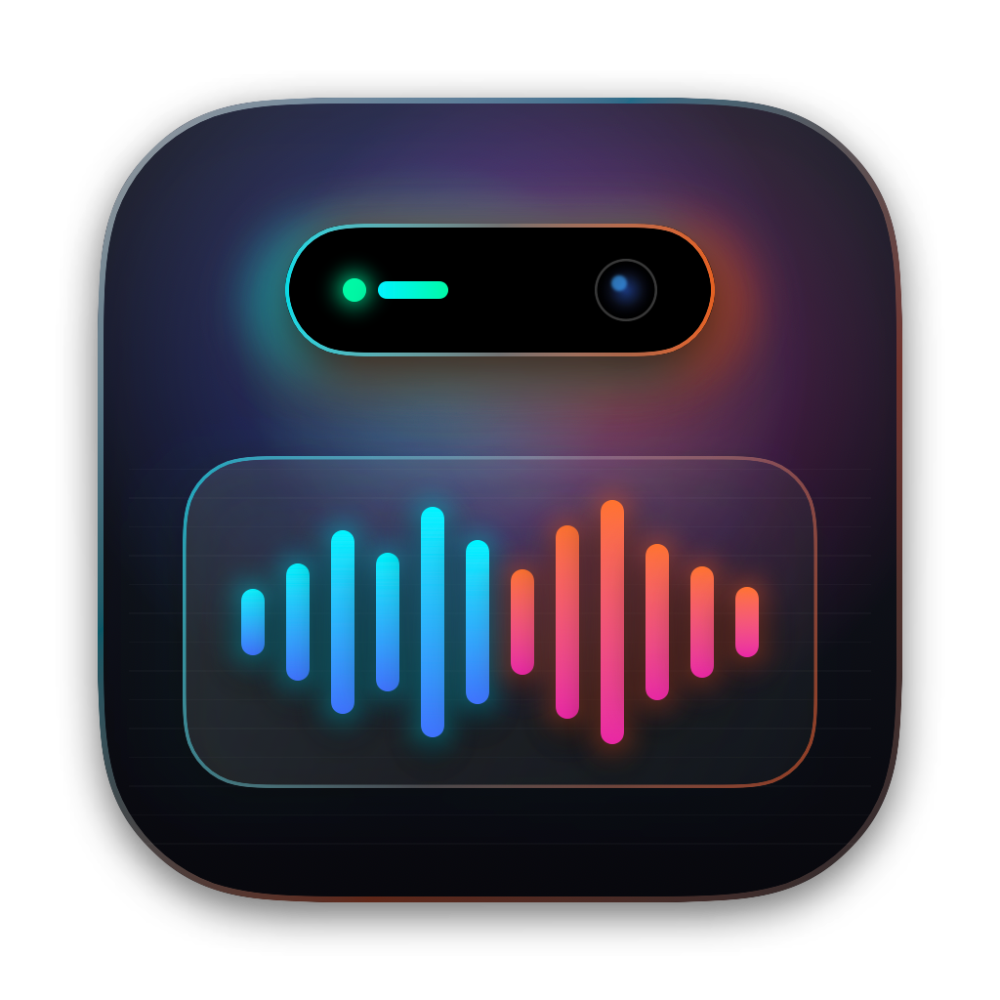
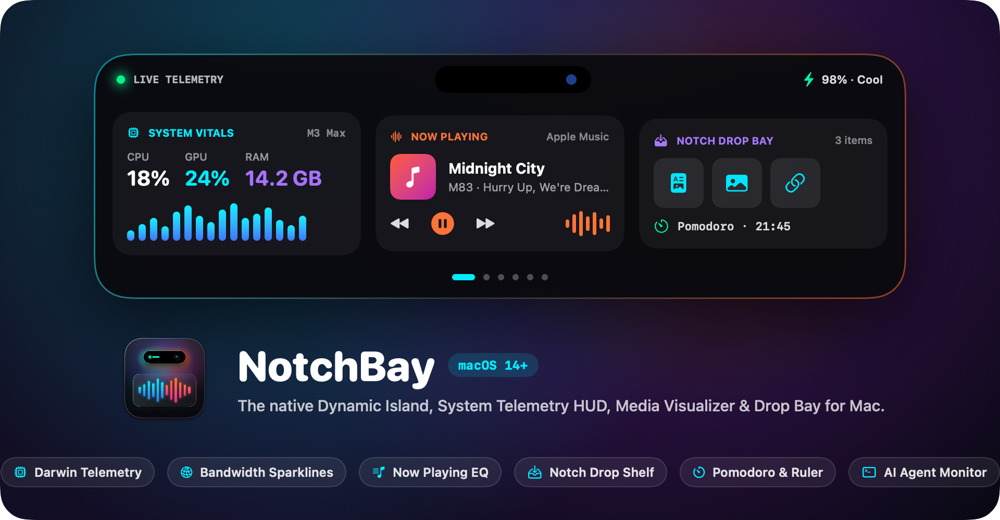
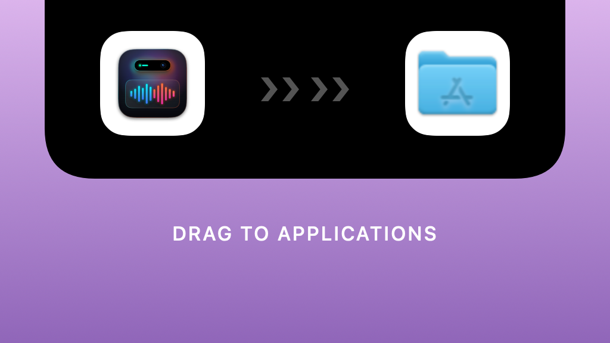

<div align="center">



# NotchBay

**The Ultimate macOS Dynamic Island & Camera Notch Command Center.**  
*Dock, drop, monitor, and control seamlessly at the top edge of your Mac.*

[](https://github.com/PraveenWijewardana/NotchBay)
[](https://swift.org)
[](https://github.com/PraveenWijewardana/NotchBay/raw/main/NotchBay.dmg)
[](https://github.com/PraveenWijewardana/NotchBay/raw/main/NotchBay.dmg)
[](https://github.com/PraveenWijewardana)

<br />



</div>

---

## 🌟 Overview

**NotchBay** is an ultra-lightweight, 100% native macOS status hub and productivity companion written in **SwiftUI** and **AppKit**. It anchors directly to your MacBook's physical camera notch—or gracefully floats as an iPhone-style Dynamic Island on external displays and non-notch Macs.

Powered by fluid Apple spring physics (`0.38s` overshoot curve) and low-overhead kernel APIs, NotchBay turns the dead screen space around your camera into a rich, interactive HUD for system telemetry, network bandwidth, synchronized music lyrics, temporary file staging, focus timers, local weather, and AI coding agent progress.

---

## 📦 Quick Installation (`.dmg`)

<div align="center">
  <a href="https://github.com/PraveenWijewardana/NotchBay/raw/main/NotchBay.dmg">
    
  </a>
</div>

1. **[Download `NotchBay.dmg`](https://github.com/PraveenWijewardana/NotchBay/raw/main/NotchBay.dmg)** directly from this repository.
2. Open the disk image and drag **NotchBay** into your **Applications** folder.
3. If macOS Gatekeeper shows an *"unidentified developer"* prompt on first run, either **Right-Click → Open** or run:
   ```bash
   xattr -cr /Applications/NotchBay.app
   ```

---

## 🚀 Feature Highlights

### 1. 🖥️ Real-Time System Telemetry
Low-overhead hardware monitoring driven by Darwin kernel APIs (`mach_host`, `host_processor_info`, `vm_statistics64`, `statfs`, and `IOKit.ps`):
- **CPU & GPU Load**: Per-core processor load and Apple Silicon Metal load with 30s vector sparklines.
- **RAM & Memory Pressure**: Active, wired, compressed memory tracking with swap warnings.
- **Disk I/O**: Real-time read (`R`) and write (`W`) filesystem throughput.
- **Power & Thermals**: Battery health, charging wattage, cycle stats, and thermal throttling states (`Nominal`, `Fair`, `Serious`).

### 2. 🌐 Network Bandwidth & Dual-Line Waveform
- Instantaneous live download (`↓`) and upload (`↑`) transfer rates.
- Dual-line Bezier-smoothed real-time waveform chart with rolling 30-second history.
- Cumulative session counters tracking **Peak Down**, **Session Downloaded**, and **Session Uploaded**.

### 3. 🎵 Now Playing & Synchronized Live Lyrics
- Native bidirectional integration with **Apple Music** and **Spotify**.
- **Synchronized Lyrics**: Dynamic real-time scrolling lyrics with glowing neon aura for the active vocal line.
- **Media Controls**: Live album artwork, track scrubbing, animated frequency visualizer, mute toggle, and single-line volume percentage slider.

### 4. 📁 The Drop Shelf (Temporary File Stash)
- Drag and drop files, documents, screenshots, links, and code snippets straight into the notch to hold them.
- Quick preview cards with thumbnails, byte sizes, and file extensions.
- Downsampled image thumbnails for ultra-low memory usage (<25MB RAM).
- One-click copy or drag-out directly into emails, Slack, Xcode, or Finder.

### 5. 🤖 AI Code Agent Companion
- Live automatic scanner that detects background coding agents:
  - **Claude Code** (`claude`)
  - **Cursor Composer** (`cursor`)
  - **GitHub Copilot** (`copilot`)
  - **Codex** (`codex`)
  - **Aider** (`aider`)
- Surfaces live task progress, active tools, duration, cost estimations, and token burn rates in the notch.

### 6. ⏱️ Focus Timers & Tactile Ruler Dial
- **Modes**: Countdown presets (`5m`, `10m`, `25m`), automated **Pomodoro** cycles (`25m Focus / 5m Break`), and **Stopwatch** with lap split tracking.
- **Interactive Ruler Slider**: Scrub visually across tactile tick marks with mechanical click sounds and dynamic completion estimation (e.g., *"Ends at 4:30 PM"*).

### 7. 🌦️ Dynamic Weather Dashboard
- Live atmospheric particle simulations: ambient rainfall, falling snow, lightning flashes, solar flares, and twinkling night stars.
- Live temperature, feels-like temperature, humidity, wind speed, UV index, and 24-hour forecast bars.

### 8. 🔔 System HUD Overlays
- Discrete popups that animate from behind the notch:
  - **Volume HUD** & **Brightness HUD** sliders.
  - **Caps Lock** indicator status.
  - **AirDrop Transfer** progress bar and file receipt alerts.
  - **Incoming Call** banners for FaceTime, WhatsApp, and Phone.

### 9. 🔒 Pin / Keep Open Mode
- Integrated lock button on every view: pins the island open so it stays visible while clicking between other background apps without auto-collapsing.

---

## ⚙️ Preferences & Customization

Open Settings anytime with **`⌘ + ,`**:
- **Island Style & Glass Finish**: Choose from **True Black (OLED)**, **Frosted Dark**, **Neon Cyber**, or **Ultra Thin Glass**.
- **Frosted Translucent Header**: Settings window features an Apple `.ultraThinMaterial` blurred top bar with custom opacity.
- **Compact Ear Customization**: Customize left and right pill ear widths (`60pt` – `100pt`) and choose which metrics appear while collapsed.
- **Accent Colors**: Neon Cyan, Cyber Purple, Electric Green, Sunset Orange, Hot Pink, or Solar Yellow.
- **Floating Island Mode**: Adjustable top margin (`4pt` – `28pt`) and corner radius (`16pt` – `36pt`) for external monitors and non-notch Macs.

---

## ⌨️ Keyboard Shortcuts

| Shortcut | Action |
| :--- | :--- |
| **`⌘ + I`** | Toggle NotchBay (Compact Pill ↔ Expanded Island) |
| **`⌘ + ,`** | Open Preferences / Settings Window |
| **`⌘ + 1`** | Switch to **Home** Dashboard |
| **`⌘ + 2`** | Switch to **System Telemetry** |
| **`⌘ + 3`** | Switch to **Focus Timers** |
| **`⌘ + 4`** | Switch to **Now Playing Media & Lyrics** |
| **`⌘ + 5`** | Switch to **Drop Shelf** |
| **`⌘ + 6`** | Switch to **AI Code Agents** |
| **`⌘ + 7`** | Switch to **Weather Dashboard** |
| **`⌘ + 8`** | Switch to **Calendar Schedule** |
| **`⌘ + R`** | Recenter NotchBay on Active Screen |
| **`⌘ + Q`** | Quit NotchBay |

---

## 🛠️ Build from Source

### Prerequisites
- macOS 14.0 (Sonoma) or macOS 15+ (Sequoia)
- Xcode 16+ or Swift 6.0+ toolchain

### Build Steps
```bash
# Clone the repository
git clone https://github.com/PraveenWijewardana/NotchBay.git
cd NotchBay

# Build and run directly via Xcode
open DynamicIsland.xcodeproj

# Or compile a Release build via CLI
xcodebuild -project DynamicIsland.xcodeproj \
           -scheme DynamicIsland \
           -configuration Release \
           -derivedDataPath /tmp/build \
           build ONLY_ACTIVE_ARCH=YES
```

---

## 🏗️ Repository Architecture

```text
NotchBay/
├── DynamicIsland/
│   ├── DynamicIslandApp.swift       # @main application lifecycle entry point
│   ├── AppDelegate.swift            # Menu bar item & window controller integration
│   ├── Window/                      # Floating NSPanel, Settings window, & Top-anchored ViewModel
│   ├── Models/                      # Telemetry, AppSettings, Media, Weather, Timer, & Agent data structures
│   ├── Services/                    # Darwin Mach kernel monitors, EventKit, Audio visualizer, AppleScript
│   ├── Views/
│   │   ├── CompactIslandView.swift  # Collapsed camera notch ear pill
│   │   ├── ExpandedIslandView.swift # Main container holding tabs & quick-switchers
│   │   ├── Home/                    # Bento overview & audio quick-controls
│   │   ├── System/                  # CPU, GPU, RAM, Disk, Network, & Battery views
│   │   ├── Media/                   # Album art, lyrics viewer, & waveform equalizer
│   │   ├── Shelf/                   # Temporary file drop staging shelf
│   │   ├── Timers/                  # Pomodoro, countdown presets, & ruler dial
│   │   ├── Weather/                 # Atmospheric particle canvas & forecast
│   │   ├── Agent/                   # Coding agent companion & telemetry
│   │   ├── HUD/                     # Volume, Brightness, AirDrop, & Call indicators
│   │   └── Settings/                # Preference panes with frosted glass styling
│   └── Resources/                   # Info.plist, Entitlements, Assets.xcassets, & AppIcon.icns
├── assets/                          # App icons, retina DMG backgrounds, & showcase previews
├── NotchBay.dmg                     # Universal macOS disk image installer
└── Package.swift                    # Swift Package Manager manifest
```

---

## 👨‍💻 Author & Maintainer

**Praveen Wijewardana**  
- GitHub: [@PraveenWijewardana](https://github.com/PraveenWijewardana)
- Repository: [PraveenWijewardana/NotchBay](https://github.com/PraveenWijewardana/NotchBay)

---

## 📄 License

This project is licensed under the [MIT License](LICENSE).
Feel free to star ⭐ the repository if you find NotchBay useful!
